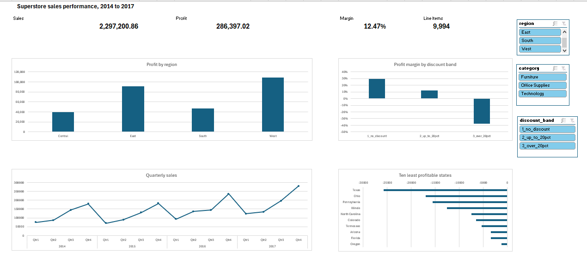
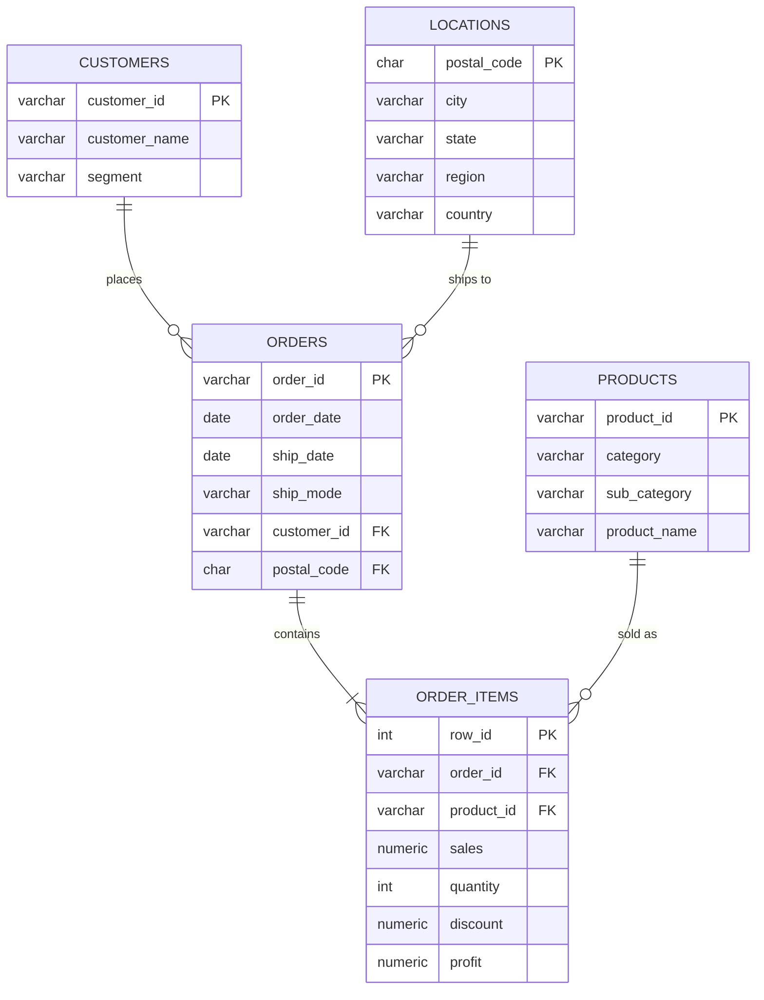

# Superstore sales performance: PostgreSQL and Excel

A sales and profitability analysis of the Superstore sample dataset (9,994 order lines, 2014 to 2017). The raw flat file was normalised into a relational PostgreSQL schema, analysed with SQL (joins, CTEs, window functions, subqueries, views), and turned into an interactive Excel dashboard with pivot tables, slicers and `XLOOKUP`.



## Key findings

- **Lines discounted by more than 20% are where the losses are.** Lines discounted by more than 20% have a margin of -37.32% and lose 135,376, about 47% of the company's reported profit of 286,397. Undiscounted lines earn 29.51%.
- **Every loss-making state is a fully discounted state.** Ten states lose money (Texas, Ohio, Pennsylvania, Illinois, North Carolina, Colorado, Tennessee, Arizona, Florida, Oregon). All ten are among the 11 states where every order line carries a discount.
- **Central's weak margin comes from two states.** Texas and Illinois lose 38,337 together; the other 11 Central states are profitable.

The full write-up, with numbers and caveats, is in [findings.md](findings.md). The dataset looks synthetic, so these patterns describe this dataset and say nothing about a real retailer, and they show association, not cause.

## What is in this repository

```
sales-performance-sql/
├── README.md
├── findings.md                      written summary of the results
├── images/dashboard.png             screenshot of the Excel dashboard
├── sql_schema/
│   ├── create_tables.sql            five-table schema with keys
│   └── load_data.sql                staging table, cleaning and loading
└── sql_queries/
    └── analysis_queries.sql         ten analysis queries and two views
```

The raw CSV and the Excel workbook are not included, because the workbook contains every row of the dataset and the dataset's licence does not clearly allow redistribution (see Data source below). Download the CSV from Kaggle and place it in a folder called `data_raw/`.

## Data model

The source file is one flat table. It was split into five tables with primary and foreign keys:



Two views sit on top for analysis and for Excel: `v_sales_detail` (one row per line item, with all descriptive fields and a discount band) and `v_customer_summary` (one row per customer).

## Data cleaning decisions

| Problem found in the source file | How it was handled |
|---|---|
| 449 postal codes had lost their leading zero (for example `1040` instead of `01040`) | Padded to five digits with `LPAD` when loading |
| The CSV is Windows-1252 encoded, not UTF-8 | Imported with encoding `WIN1252` |
| Dates are in US month/day/year format | Converted with `TO_DATE(..., 'MM/DD/YYYY')` |
| 32 product IDs appear with more than one product name | Kept the name from the first occurrence (lowest Row ID) |
| Postal code 92024 appears with two city names | Kept the most frequent city (San Diego, 34 rows, over Encinitas, 5 rows) |
| Rounding inside a view made totals drift by cents | Money columns kept at full precision in views; rounding only for display |

Each check (row counts, totals of sales, profit and quantity) was compared between the staging table and the final tables, and between SQL and the Excel pivot tables.

## How to rebuild

1. Install PostgreSQL 18 and pgAdmin, and create a database named `superstore_sales`.
2. Run `sql_schema/create_tables.sql`.
3. Download the CSV from Kaggle and save it in `data_raw/`.
4. In `sql_schema/load_data.sql`, run the first section (it creates the staging table `staging_superstore`).
5. Import the CSV into `staging_superstore` with pgAdmin (right-click the table, Import/Export Data): format `csv`, encoding `WIN1252`, header on, delimiter `,`, quote and escape `"`. Expect 9,994 rows.
6. Run the rest of `load_data.sql`. The final check must show 9,994 line items, sales of 2,297,200.86, profit of 286,397.02 and quantity of 37,873.
7. Run `sql_queries/analysis_queries.sql`. It runs the ten analysis queries and creates the two views.

## Excel workbook

The dashboard was built locally and is shown in the screenshot above; the workbook itself is not published (see above). It loads the two views through Power Query over an ODBC connection to a local PostgreSQL database (PostgreSQL ODBC driver, 64-bit), so it can be rebuilt after step 7. It contains:

- pivot tables for region, state (with conditional formatting that marks loss-making states in red), discount band and time;
- a customer lookup built with `XLOOKUP`;
- a dashboard with four KPIs, four pivot charts and three slicers (region, category, discount band) connected to every pivot.

Notes:

- The Excel Data Model is not used, so the dashboard counts order lines and not distinct orders.

## Skills demonstrated

- **SQL:** relational schema design, inner joins and a `LEFT JOIN` anti-join, CTEs, window functions (`RANK`, `LAG`, running total), subqueries, conditional aggregates (`FILTER`), `CASE`, views.
- **Data cleaning:** encoding, date formats, leading zeros, inconsistent keys, with a staging-table load.
- **Excel:** pivot tables and pivot charts, calculated fields, slicers, `GETPIVOTDATA`, `XLOOKUP`, conditional formatting.

## Data source

Superstore Dataset (Kaggle, user vivek468): https://www.kaggle.com/datasets/vivek468/superstore-dataset-final. The uploader states that they do not own the data (it comes from Tableau's sample data) and that it is "for educational purposes only"; Kaggle lists the licence as "Other (specified in description)". Because redistribution is not clearly permitted, this repository contains no copy of the data.
